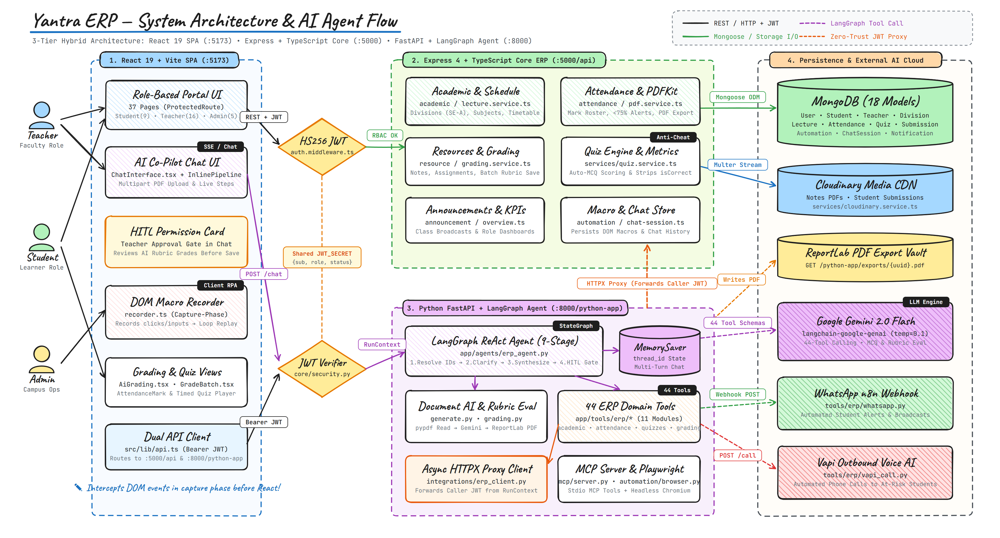
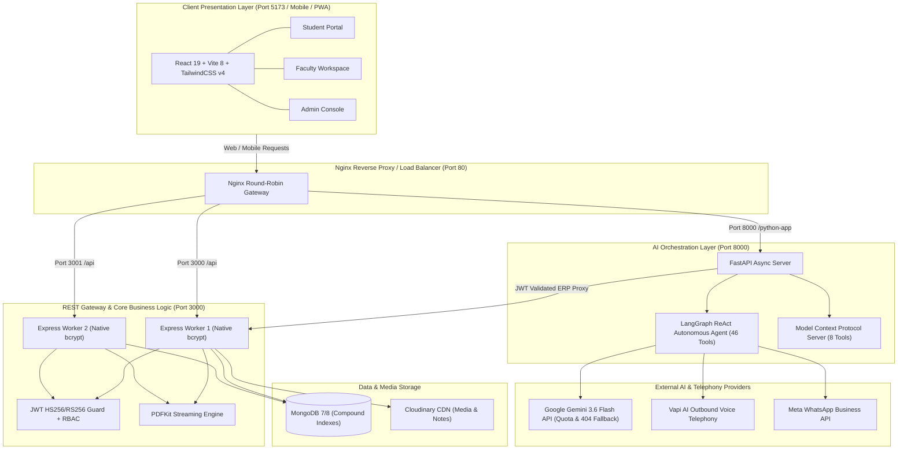

# 🎓 Yantra — Intelligent Campus ERP & AI Automation Platform

[](https://react.dev/)
[](https://www.typescriptlang.org/)
[](https://nodejs.org/)
[](https://expressjs.com/)
[](https://fastapi.tiangolo.com/)
[](https://www.python.org/)
[](https://www.mongodb.com/)
[](https://ai.google.dev/)
[](https://www.docker.com/)
[](https://tailwindcss.com/)

**Yantra** is a unified, production-hardened Educational Resource Planning (ERP) platform and autonomous AI automation suite designed to transform campus administration for students, faculty, and university leadership. It fuses real-time academic workflows, digital attendance marking, anti-cheat assessments, and rubric-driven grading with an autonomous **46-tool LangGraph ReAct AI agent** and an **8-tool Model Context Protocol (MCP) server** capable of executing complex administrative actions from plain English.

---

## 🏛️ System Architecture



Yantra is organized as a high-performance monorepo partitioned into three dedicated service layers with optional Nginx load balancing:

```
hackathonno3/
├── frontend/             # Single-page application (React 19 + Vite 8 + TailwindCSS v4 + PWA)
├── express-backend/      # Core REST API, Auth, MongoDB Schemas & Business Logic (Node.js + native bcrypt)
├── python-backend/       # Autonomous AI Engine, LangGraph Agent & MCP Stdio Server (FastAPI + Gemini)
├── demo-video/           # Automated Playwright + ffmpeg walkthrough recorder & voiceover muxer (media gitignored)
├── docker-compose.yml    # Multi-container orchestration (Nginx, 2x Express, 2x FastAPI, Redis, MongoDB, RO mongo-express)
├── benchmarks/           # Scale & load testing suite (scale_test.py, load_test.py)
├── start.sh              # Single-command unified launcher for local development
├── SLIDE_FACTS.md        # Single source of truth telemetry & verification audit
└── README.md             # Complete documentation
```

### High-Level Service Architecture



---

## ⚡ Quick Start: Zero to Running in 60 Seconds

### Prerequisites
- **Node.js**: v20.x or higher (`node -v`)
- **Python**: v3.11 or higher (`python3 --version`)
- **uv**: Modern, ultra-fast Python package runner (`curl -LsSf https://astral.sh/uv/install.sh | sh`)
- **MongoDB**: Local MongoDB daemon running on `mongodb://127.0.0.1:27017` or a MongoDB Atlas URI

### 🚀 Option A: One-Command Local Launch (Recommended for Dev)

Run the unified startup script from the project root:

```bash
chmod +x ./start.sh
./start.sh
```

This single command launches:
1. **Express REST Backend** at `http://localhost:3000`
2. **Python AI Backend** at `http://localhost:8000`
3. **Frontend Dashboard** at `http://localhost:5173`

*(Press `Ctrl+C` at any time to gracefully terminate all background services).*

---

### 🐳 Option B: Full Multi-Container Docker Cluster

Launch the complete load-balanced cluster (including Nginx load balancer and dual Express instances) with a single command:

```bash
docker compose up --build -d
```

| Service | Container Name | Port / Host Mapping | Description |
| :--- | :--- | :--- | :--- |
| **Nginx Gateway** | `yantra-nginx` | `http://localhost:80` | Public reverse proxy load-balancing requests across all replicas |
| **Express Backend #1** | `yantra-express-1` | `http://localhost:3000` (internal) | Node.js REST API worker 1 |
| **Express Backend #2** | `yantra-express-2` | `http://localhost:3000` (internal) | Node.js REST API worker 2 |
| **Python FastAPI #1** | `yantra-fastapi-1` | `http://localhost:8000` (internal) | LangGraph agent and AI orchestration worker 1 |
| **Python FastAPI #2** | `yantra-fastapi-2` | `http://localhost:8000` (internal) | LangGraph agent and AI orchestration worker 2 |
| **Frontend UI** | `yantra-frontend` | `http://localhost:80` (routed) | Production single-page application served via Nginx |
| **MongoDB Database** | `yantra-mongo` | `mongodb://localhost:27018` | Persistent database storage |
| **Redis Cache** | `yantra-redis` | `localhost:6379` | In-memory cache and session state |

---

## 🔑 Demo Accounts & Pre-Seeded Logins

The application includes rich, realistic university data across divisions (`TE-A`, `TE-B`, `TE-C`), subjects, scheduled lectures, attendance records, and quiz submissions:

| Role | Email | Password | Primary Capabilities |
| :--- | :--- | :--- | :--- |
| **Administrator** | `admin@university.edu` | `AdminPassword123!` | Academic Setup (classes & subjects), faculty onboarding & verification, division oversight, audit logs |
| **Faculty / Teacher** | `prof.adrian@university.edu` | `Teacher123` | Single-click attendance, schedule builder, AI rubric grading, DOM macro recorder, compliance export |
| **Student** | `aarav.sharma@university.edu` | `Student123` | Attendance health & recovery plan, **Upload notice** deadline extraction, anti-cheat timed quizzes |
| **Parent** | `parent.sharma@university.edu` | `Parent123!` | Strictly read-only portal scoped to linked student's attendance & recovery status |

---

## 🛠️ Manual Tier-by-Tier Setup

If you prefer to run or debug tiers individually in separate terminals:

### Tier 1: Express REST Backend (`express-backend/`)

> [!NOTE]
> On macOS, AirPlay Receiver listens on port 5000 by default. Yantra's Express backend runs on **port 3000** to avoid collisions.

```bash
cd express-backend
npm install

# 1. Environment Configuration
cp .env.example .env
```

Ensure `express-backend/.env` contains:
```ini
PORT=3000
NODE_ENV=development
CORS_ORIGIN=http://localhost:5173
MONGODB_URI=mongodb://127.0.0.1:27017/yantra_erp
JWT_SECRET=replace-with-a-long-random-secret
JWT_EXPIRES_IN=7d
BCRYPT_SALT_ROUNDS=10

ADMIN_EMAIL=admin@university.edu
ADMIN_PASSWORD=ChangeMeNow!
ADMIN_NAME=Admin Console

# Cloudinary Storage
CLOUDINARY_CLOUD_NAME=your_cloudinary_cloud_name
CLOUDINARY_API_KEY=your_cloudinary_api_key
CLOUDINARY_API_SECRET=your_cloudinary_api_secret
CLOUDINARY_FOLDER=yantra_erp/resources
```

```bash
# 2. Compile TypeScript & Seed Database
npm run build
npm run seed:demo       # Seeds divisions, teachers, students, lectures, quizzes & attendance

# 3. Start Development Server
npm run dev
```

---

### Tier 2: Python AI & LangGraph Backend (`python-backend/`)

```bash
cd python-backend

# 1. Sync Dependencies using uv
uv sync

# 2. Environment Configuration
cp .env.example .env
```

Ensure `python-backend/.env` contains:
```ini
HOST=0.0.0.0
PORT=8000
ENVIRONMENT=development
CORS_ORIGINS=http://localhost:5173

# Must match JWT_SECRET in express-backend
JWT_SECRET=replace-with-a-long-random-secret
NODE_API_URL=http://localhost:3000/api

# Gemini AI Engine
GEMINI_API_KEY=your_gemini_api_key_here
GEMINI_MODELS=gemini-3.6-flash,gemini-2.5-flash
GEMINI_MODEL=gemini-3.6-flash

# Optional Telephony / Messaging
VAPI_API_KEY=your_vapi_key
VAPI_PHONE_NUMBER_ID=your_phone_id
VAPI_ASSISTANT_ID=your_assistant_id
WHATSAPP_TOKEN=your_whatsapp_token
WHATSAPP_PHONE_NUMBER_ID=your_whatsapp_phone_number_id
```

```bash
# 3. Run Automated Tests
uv run pytest -q

# 4. Start Uvicorn Server
uv run uvicorn app.main:app --reload --port 8000
```
- Health Check: `http://localhost:8000/python-app/health`
- Swagger UI Documentation: `http://localhost:8000/docs`

---

### Tier 3: React 19 Frontend (`frontend/`)

```bash
cd frontend
npm install

# 1. Environment Configuration
cp .env.example .env
```

Ensure `frontend/.env` contains:
```ini
VITE_API_URL=http://localhost:3000/api
VITE_AI_API_URL=http://localhost:8000/python-app
```

```bash
# 2. Start Vite Dev Server
npm run dev
```

Open `http://localhost:5173` in your browser.

---

## 🚀 Cloud Deployment Guide (Vercel & Render)

### 1. Deploying the Frontend to Vercel

When deploying the `frontend/` directory to Vercel:

1. **Framework Preset**: Vite
2. **Root Directory**: `frontend`
3. **Build Command**: `npm run build`
4. **Output Directory**: `dist`
5. **Environment Variables**:

> [!IMPORTANT]
> When deploying the frontend to Vercel, you **MUST** provide the live public URLs for `VITE_API_URL` and `VITE_AI_API_URL`. Relative paths (`/api`) only resolve when running locally behind Vite's dev server or behind Nginx in Docker Compose. Standalone Vercel deployments host only static client assets, so omitting these variables or entering relative paths will cause all API calls to 404.
>
> In the Vercel dashboard, make sure each variable has its own distinct Key and Value:

| Key | Value Description | Example Value |
| :--- | :--- | :--- |
| `VITE_API_URL` | Live URL of your deployed Express backend | `https://yantra-express.onrender.com/api` |
| `VITE_AI_API_URL` | Live URL of your deployed Python AI backend | `https://yantra-ai.onrender.com/python-app` |

---

### 2. Deploying the Backends & Database to Render & MongoDB Atlas

Both backends include multi-stage production Dockerfiles ready for containerized deployment on **Render**:

#### A. Database: Managed MongoDB Atlas
1. Create a free M0 cluster on [MongoDB Atlas](https://www.mongodb.com/atlas).
2. Under **Network Access**, add `0.0.0.0/0` (allow access from anywhere) so Render container instances can connect.
3. Under **Database Access**, create a database user and copy the connection URI:
   ```text
   mongodb+srv://<username>:<password>@cluster0.mongodb.net/yantra_erp?retryWrites=true&w=majority
   ```

#### B. Express REST Backend (`express-backend/`)
1. Create a new **Web Service** on Render connected to this repository.
2. **Environment**: Docker (Root Directory: `express-backend`, Dockerfile: `Dockerfile`).
3. Render automatically injects a dynamic `$PORT` variable into the container.
4. **Environment Variables**:
   * `NODE_ENV=production`
   * `PORT=3000` (Render will bind its assigned port)
   * `MONGODB_URI=<your MongoDB Atlas connection string>`
   * `JWT_SECRET=<32+ char random production secret>`
   * `CORS_ORIGIN=https://<your-app>.vercel.app` (your live Vercel frontend URL)
   * `TRUST_PROXY=1` (Render acts as the TLS-terminating reverse proxy)
   * `CLOUDINARY_CLOUD_NAME`, `CLOUDINARY_API_KEY`, `CLOUDINARY_API_SECRET`

#### C. Python AI Backend (`python-backend/`)
1. Create a second **Web Service** on Render.
2. **Environment**: Docker (Root Directory: `python-backend`, Dockerfile: `Dockerfile`).
3. **Environment Variables**:
   * `ENVIRONMENT=production`
   * `PORT=8000`
   * `NODE_API_URL=https://<your-express-service>.onrender.com/api`
   * `MONGODB_URI=<your MongoDB Atlas connection string>`
   * `JWT_SECRET=<must match express-backend JWT_SECRET>`
   * `CORS_ORIGINS=https://<your-app>.vercel.app`
   * `GEMINI_API_KEY=<your Google Gemini API key>`
   * `GEMINI_MODELS=gemini-3.6-flash,gemini-2.5-flash`
   * `PROXY_HEADERS=true`
   * `FORWARDED_ALLOW_IPS=*`

---

## 🌟 Key Features & Functional Modules

### 1. 📱 Responsive Touch & Mobile Drawer Navigation
- **Off-Canvas Mobile Drawer**: On screen widths $\le 768\text{px}$, the desktop sidebar auto-collapses off-canvas and opens via a mobile hamburger button with a darkened tap backdrop.
- **Auto-Close on Navigation**: Transitions between views automatically close the drawer, ensuring a smooth app-like touch experience.
- **Viewport Protection**: Form inputs enforce `16px` base font size to prevent iOS Safari auto-zooming on focus.
- **Scrollable Data Tables**: Data tables feature horizontal touch scrolling (`overflow-x: auto; -webkit-overflow-scrolling: touch`) to eliminate mobile layout clipping.

### 2. 🤖 Autonomous AI Campus Agent (46 Tools + 8 MCP Tools)
- **LangGraph ReAct Loop**: Processes natural language commands across academics, scheduling, and notifications:
  - *"Mark Aarav Sharma absent for today's Database Management lecture"*
  - *"Send a WhatsApp reminder to all defaulters in TE-A about tomorrow's internal assessment"*
  - *"Create a 10-question multiple-choice quiz on Operating System deadlocks for Third Year A"*
- **Multi-Model Quota & 404 Fallback**: Intelligent failover system dynamically falls back (`Gemini 3.6 Flash` $\to$ `Gemini 2.5 Flash` configured via `GEMINI_MODELS`) if API rate limits (429) or model deprecation/not-found (404) are encountered.
- **Standard Model Context Protocol (MCP)**: Native stdio MCP server (`python-backend/mcp_server.py`) exposing 8 tools for external IDEs and agents.
- **Vapi Voice Calling**: Outbound voice agent can call students or parents directly regarding critical attendance warnings.

### 3. 📝 Anti-Cheat Quizzes & Automated Assessments
- **Server-Side Answer Scrubbing**: Option `isCorrect` keys are stripped before serving quiz payloads to student clients, preventing inspection via browser developer tools.
- **Auto-Grading Engine**: Instant score calculation for objective questions upon submission; subjective answers route to faculty review queues.
- **Score Analytics**: Real-time histograms, average completion times, and student leaderboards.

### 4. 📊 Assignment Submissions & AI Rubric Grading
- **Multi-File Cloud Submissions**: Seamless file uploads directly to Cloudinary CDN with due-date enforcement.
- **Rubric-Based AI Evaluation**: Gemini AI reads student submissions, evaluates them against teacher-defined rubrics, generates constructive feedback, and queues scores for teacher approval (human-in-the-loop).
- **Text Similarity Detection**: 3-gram text shingling and Jaccard similarity comparisons flag peer submission overlaps (`similarity_flagged`).

### 5. 🎯 Digital Attendance Tracking & Verification
- **One-Click Marking**: Quick Present/Absent/Late status toggling with instant percentage circle visualization.
- **URL Parameter State Sync (`/attendance/mark?lectureId=...`)**: Retains deep links and shareable faculty URLs across reloads.
- **Defaulter Focus List**: Real-time aggregation calculates at-risk students below 75% attendance.
- **Server-Side PDF Streaming**: One-click generation of PDF attendance sheets and division reports built with PDFKit.

### 6. 🧠 Academic Intelligence, Notice Upload, Parent Portal & Compliance
- **Admin Academic Setup (`/admin/academic-setup`)**: Admin-only forms and APIs (`POST /api/academic/divisions`, `POST /api/academic/subjects`) with Zod validation, duplicate checks, and automatic relational-link resolution (`divisionRef`, `branchRef`, `divisionRefs`, `subjectRefs`) at user registration.
- **Student "Upload notice" Card**: Drag-and-drop or browse PNG/JPG/WEBP/PDF circulars (max 10 MB) directly on the Student Dashboard, extract structured deadlines via `POST /python-app/ingest/document` with institution-local timezone normalization (`INSTITUTION_TIMEZONE`, default `Asia/Kolkata`), review/edit flagged low-confidence fields (`"Please check"`), and explicitly save (`POST /api/deadlines/personal`) to display immediately with a `"from notice"` badge.
- **Parent Read-Only Portal (`/parent`)**: Strictly read-only, IDOR-isolated parent dashboard surfacing linked student attendance percentages and recovery status.
- **Attendance Compliance Export (`GET /api/reports/attendance-compliance`)**: Division-level CSV and PDFKit audit report exports (admin/teacher only).
- **DOM Macro Recorder & Idempotent Alert Engine**: Client-side DOM macro recorder/replay (`/automation`) plus deduplicated alert engine (`POST /api/alerts/run`, unique `dedupeKey` in `notifications`).
- **Ask My Notes (RAG)**: Deterministic **keyword (TF-IDF) retrieval** over uploaded course notes with document and section citations.
- **Timetable Conflict Detection**: Preemptive collision detection validating teacher, room, and division schedule allocations.
- **Progressive Web App (PWA)**: Web app manifest (`manifest.json`) and offline service worker (`sw.js`) for home-screen installation (Lighthouse: 100 Performance, 100 Best Practices, 98 Accessibility).

---

## 🎬 Demo Video Pipeline (`demo-video/`)

Automated Playwright + `ffmpeg` walkthrough recorder and local voiceover muxer (all rendered `.mp4`/`.m4a` media lives in `demo-video/out/` and `demo-video/audio/`, which are gitignored):

```bash
# 1. Reset isolated yantra_demo DB, start read-only mongo-express & local servers
bash demo-video/prepare.sh

# 2. Record a single scene or concatenate scenes into out/full.mp4 + out/timeline.json
cd demo-video
node record.mjs --list
node record.mjs --scene 7
node record.mjs --concat

# 3. Mux a local voiceover recording into out/final_with_voice.mp4 (-16 LUFS, 1920x1080 30fps)
node record.mjs --mux
```

---

## 📊 Measured Performance & Scaling Benchmarks

All metrics are read directly from `benchmark_results.json` (zero hand-typed figures; see `SLIDE_FACTS.md` and `BENCHMARKS.md`):
- **Measured Conditions**: Apple M4, 16.0 GB RAM, Darwin 25.6.0 (`arm64`), Node `v26.9.0`, Python `3.11.17`, commit `1d7a407`; asynchronous `httpx` + `asyncio` load generator running **on the same machine** with relaxed rate limits via `.env.bench`.

### 1. Baseline Service Throughput

| Endpoint / Subsystem | Concurrency | RPS (Throughput) | Mean Latency | p50 Latency | p95 Latency | Error Rate |
| :--- | :--- | :--- | :--- | :--- | :--- | :--- |
| **Express REST Gateway (`/health`)** | 10 | **1,775.7 RPS** | 5.63 ms | 3.28 ms | 3.88 ms | 0.0% |
| **FastAPI Agent Tools Registry (HS256)**| 10 | **951.3 RPS** | 10.49 ms | 5.74 ms | 11.44 ms | 0.0% |
| **Express Attendance Stats Pipeline** | 50 | **924.3 RPS** | 53.47 ms | 36.84 ms | 157.46 ms | 0.0% |
| **FastAPI Async Core (`/health`)** | 100 | **868.6 RPS** | 112.12 ms | 83.01 ms | 318.01 ms | 0.0% |
| **Student Quizzes (Mongo Read)** | 100 | **610.8 RPS** | 157.92 ms | 118.00 ms | 448.00 ms | 0.0% |
| **Student Dashboard Overview** | 25 | **557.9 RPS** | 44.55 ms | 41.92 ms | 59.14 ms | 0.0% |

---

### 2. Horizontal Container Scaling (1 Instance vs 2 Instances via Nginx :80)

Measured directly through the containerized Docker topology (`Nginx :80` $\to$ `2x Express`, `2x FastAPI`, `MongoDB`):

| Scenario | Concurrency | 1 Instance RPS | 2 Instances RPS | Scaling Factor | p95 (1 Inst) | p95 (2 Inst) | Notes / Honest Bottleneck |
| :--- | :--- | :--- | :--- | :--- | :--- | :--- | :--- |
| **Express Auth Login (Bcrypt)** | `25` | 17.9 RPS | **35.2 RPS** | **1.97x** | 1442.7 ms | 845.3 ms | **Near-linear CPU scaling** on libuv worker pool; cuts p95 in half. |
| **Attendance Stats Pipeline** | `50` | 266.6 RPS | **349.1 RPS** | **1.31x** | 527.3 ms | 412.5 ms | Accelerated by compound indexes; CPU-bounded aggregation pipeline. |
| **FastAPI Tools Registry** | `50` | 958.9 RPS | **1098.6 RPS** | **1.15x** | 142.5 ms | 127.5 ms | Dual FastAPI container replicas distributed via Nginx round-robin scale across separate OS processes/cores, bypassing the single-process Python GIL lock. |
| **Student Quizzes (Mongo Read)**| `50` | 331.3 RPS | **309.0 RPS** | **0.93x** | 215.9 ms | 469.2 ms | Bounded by single-host Mongo connection lock. |
| **Express Health Gateway** | `50` | 749.0 RPS | **641.7 RPS** | **0.86x** | 185.2 ms | 215.9 ms | Single-host core contention between Nginx and load generator. |

---

### 3. Bcrypt Cryptographic Migration: Pure JS `bcryptjs` vs Native C++ `bcrypt`

Replacing pure-JS `bcryptjs` (which blocks the V8 event loop during password hashing) with native `bcrypt` (which delegates to background `libuv` worker threads) eliminated login CPU saturation:

| Metric | Pure JS `bcryptjs` (Before) | Native C++ `bcrypt` (After) | Improvement Delta |
| :--- | :--- | :--- | :--- |
| **Concurrency 10 Throughput** | 18.3 RPS | **134.0 RPS** | **7.32x increase** |
| **Concurrency 10 Latency (p95)** | 649.0 ms (Saturated) | **94.7 ms** | **6.85x reduction** |
| **Concurrency 25 Throughput** | 18.5 RPS | **135.4 RPS** | **7.32x increase** |
| **Concurrency 25 Latency (p95)** | 3,520.3 ms (Saturated) | **220.9 ms** | **15.9x reduction** |
| **Hash Compatibility** | Standard Modular Crypt Format | 100% Backward Compatible | Zero migration required |

---

## 🔒 Security & Hardening Highlights

- **Zero Hardcoded Secrets**: All JWT secrets, Cloudinary credentials, and database URIs load through validated environment schemas (Zod in Node, Pydantic v2 in Python). Verified clean by `check-secrets.sh`.
- **Dual-Layer JWT Authentication**: Express and FastAPI share JWT verification; the Python backend verifies credentials before executing any privileged ERP tool.
- **Configurable Rate Limiting**: Dual-tier rate limiting via `express-rate-limit` on Express login (20 req / 15 min) and write routes (60 req / min), and `slowapi` on FastAPI agent chat (30 req / min).
- **Distributed Request Tracing**: End-to-end `X-Request-Id` correlation propagation across both Express and FastAPI layers with structured context logging.
- **Compound MongoDB Indexes**: Query execution on attendance queries upgraded from `SORT` (blocking in-memory sort) to `FETCH` using `{ division: 1, subject: 1, markedAt: -1 }`.
- **Role-Based Access Control (RBAC)**: Strict `requireAuth`, `requireActiveAccount`, and `requireRole('admin', 'teacher', 'student')` guards across all state-changing endpoints.
- **Defense in Depth**: Helmet HTTP security headers, CORS origin enforcement, and Bcrypt password hashing (10 salt rounds).

---

## 🧪 Testing & Verification Suite

The repository includes a comprehensive, automated test suite covering all tiers:

```bash
# 1. Python Offline Unit Tests (13 tests: Gemini models, proxy rate limit, notice ingest & timezone, PermissionCard resume)
cd python-backend
uv run pytest -q tests/test_gemini_models.py tests/test_proxy_rate_limit.py tests/test_ingest.py tests/test_permission_resume.py

# 2. Express Backend Build & Tests (9 tests: Admin Academic Setup RBAC & relational user links)
cd ../express-backend && npm test

# 3. Frontend State-Machine Tests (6 tests) & Production Build
cd ../frontend
node --experimental-strip-types --test src/components/dashboard/uploadNoticeState.test.ts
npm run build

# 4. Secret Leakage Audit
cd .. && bash scripts/check-secrets.sh
```

**Test Suite Coverage Summary:**
- RBAC validation, admin-only Academic Setup & privilege escalation prevention
- Deterministic `PermissionCard` approval/denial resume & awaited audit log persistence
- Notice OCR upload validation (415/413/429 sanitization) & `Asia/Kolkata` timezone normalization
- Anti-cheat quiz answer scrubbing (`isCorrect` stripped server-side)
- Attendance recovery planner formulas ($\max(0, 3 \times \text{total} - 4 \times \text{attended})$)
- IDOR isolation on parent portal & student records
- Text shingling Jaccard submission similarity check
- MCP stdio tool schemas & protocol adherence (8 tools)
- Idempotent alert engine deduplication

---

## 🏆 Hackathon Submission

* **Project**: **Yantra** — Intelligent Campus ERP & AI Automation Platform
* **Team**: **Team Karatsuba** (6 members)
  * TODO: Member 1
  * TODO: Member 2
  * TODO: Member 3
  * TODO: Member 4
  * TODO: Member 5
  * TODO: Member 6
* **Submission Links**:
  * **Demo Video**: `TODO: <add demo video link>`
  * **Presentation Slides**: `TODO: <add slides link>`
* **Folder Map**:
  * `frontend/` — React 19 + Vite 8 + TailwindCSS v4 SPA (Student, Teacher, Admin, Parent portals)
  * `express-backend/` — Node.js / Express / Mongoose core ERP API, native `bcrypt`, PDFKit reports, alert engine
  * `python-backend/` — FastAPI + LangGraph 46-tool AI agent, notice OCR ingest, TF-IDF Ask My Notes, 8-tool MCP stdio server
  * `demo-video/` — Reproducible Playwright + `ffmpeg` demo recorder, local transcription & `--mux` voiceover pipeline (media gitignored)
  * `benchmarks/` & `benchmark_results.json` — Reproducible load & 1-vs-2 container scaling suite

---

## 👨‍💻 Project Maintainers & Contributors

- **Omkar Patil** ([@Omkarop0808](https://github.com/Omkarop0808))
- **Shreyas Divekar** ([@Shreyas-fr](https://github.com/Shreyas-fr))
