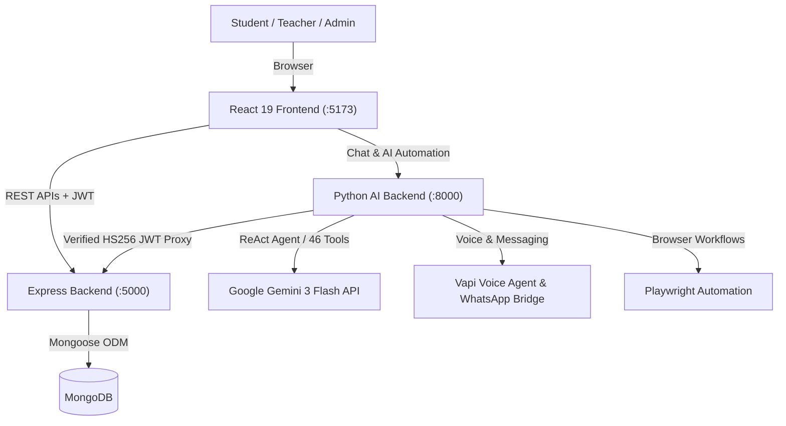

# Yantra — Intelligent Campus ERP & AI Automation Platform

[](https://nodejs.org/)
[](https://www.typescriptlang.org/)
[](https://react.dev/)
[](https://fastapi.tiangolo.com/)
[](https://www.python.org/)
[](https://tailwindcss.com/)
[](https://www.mongodb.com/)
[](LICENSE)

**Yantra** is a unified Educational Resource Planning (ERP) platform and AI automation suite designed to streamline campus management for students, teachers, and educational administrators. It integrates real-time academic workflows, attendance tracking, quiz management, automated assignment evaluation, and generative AI tool calling into a single, cohesive system.

---

## Architecture Overview


Yantra is structured as a high-performance monorepo with three specialized layers:

```
YANTRA-Intelligent-Campus-ERP-and-AI-Automation-Platform/
├── frontend/             # Single-page application (React 19 + Vite + TailwindCSS v4)
├── express-backend/      # Core REST API, Auth & Business Logic (Node.js + Express + TypeScript + MongoDB)
├── python-backend/       # AI Orchestration, LangGraph Agents & Automation (FastAPI + Gemini 3 Flash + Playwright)
└── README.md             # Project documentation, architecture, and developer guide
```



---

## Core Capabilities

### 1. Role-Based Portals & Dashboards
- **Student Portal**: Real-time view of attendance percentages, upcoming lecture schedules, pending assignments, quiz attempts, grades, and campus announcements.
- **Teacher Workspace**: Lecture creation, digital checklist attendance marking, batch & rubric-based grading, quiz creation with auto-grading, and class notifications.
- **Admin Console**: Platform oversight, student/teacher account approvals, user role management, system health metrics, and audit logs.

### 2. Digital Attendance Tracking & Validation
- Instant single-click attendance marking for scheduled lectures.
- Automated validation prevents duplicate or out-of-division submissions.
- Real-time attendance percentage computation and at-risk student detection (<75%).
- Automated PDF attendance roster exports generated server-side with PDFKit.

### 3. Resource & Assignment Management
- Centralized repository for lecture notes, study materials, and assignments.
- Student file submissions with due-date tracking and status validation.
- Cloudinary integration for scalable file and document storage.

### 4. Interactive Quizzes & Assessments
- Flexible quiz authoring supporting multiple-choice, single-choice, and open-ended questions.
- Anti-cheat question delivery: Option answer keys (`isCorrect`) are securely stripped before sending quizzes to student clients.
- Instant automated scoring for objective questions and teacher review interfaces for subjective answers.
- Comprehensive quiz analytics including score distributions, average completion times, and leaderboards.

### 5. AI Orchestration & Natural Language Workflows
- **LangGraph ReAct Agent**: Converts natural language prompts (e.g., *"Upload notes for Chapter 3 of DSA to division TE-A"* or *"Create a 5-question quiz on binary search trees"*) into structured ERP operations.
- **Tool Calling Suite**: 46 domain tools covering academic divisions, subjects, resources, quizzes, attendance records, rubric grading, PDF generation, outbound voice calls (Vapi), and WhatsApp reminders.
- **AI-Assisted Grading**: Evaluation models grade student submissions against rubrics with structured feedback, point breakdowns, and human-in-the-loop teacher approval before publishing.
- **Browser Automation**: Playwright-backed replay engine and DOM macro recorder for automated campus workflows.
- **Model Context Protocol (MCP)**: Built-in MCP server support for exposing ERP tools to MCP-compatible AI clients.

---

## Technology Stack

| Layer | Technologies |
|---|---|
| **Frontend** | React 19, TypeScript, Vite 8, TailwindCSS v4, React Router v7, Lucide React, React Toastify |
| **Backend API** | Node.js, Express 4, TypeScript 5.6, Mongoose 8 (MongoDB), JWT (`jsonwebtoken`), Bcrypt.js, Helmet, Winston, Multer, Cloudinary, PDFKit, Zod |
| **AI / Automation** | Python 3.11+, FastAPI, Uvicorn, Google Gemini (`google-genai`, `langchain-google-genai`), LangChain, LangGraph, Playwright, ReportLab, PyPDF, Pydantic v2, Structlog |
| **Package Management** | npm (Frontend & Node Backend), uv (Python Backend) |

---

## Getting Started

### Prerequisites
- **Node.js**: v20.x or later (`node -v`)
- **Python**: v3.11 or later (`python --version`)
- **uv**: Fast Python package manager (`uv --version`)
- **MongoDB**: Local MongoDB instance (`mongodb://127.0.0.1:27017`) or MongoDB Atlas URI

---

### Step 1: Clone the Repository

```bash
git clone https://github.com/Omkarop0808/YANTRA-Intelligent-Campus-ERP-and-AI-Automation-Platform.git
cd YANTRA-Intelligent-Campus-ERP-and-AI-Automation-Platform
```

---

### Step 2: Configure Express Backend

```bash
cd express-backend
npm install
cp .env.example .env
```

Edit `.env` to match your local setup:
```ini
PORT=5000
NODE_ENV=development
CORS_ORIGIN=http://localhost:5173
MONGODB_URI=mongodb://127.0.0.1:27017/yantra_erp
JWT_SECRET=your-secure-jwt-secret-key-min-32-chars
JWT_EXPIRES_IN=7d
BCRYPT_SALT_ROUNDS=10
ADMIN_EMAIL=admin@university.edu
ADMIN_PASSWORD=AdminPassword123!
ADMIN_NAME=Admin Console
```

Build and seed the database:
```bash
# Compile TypeScript
npm run build

# Seed all initial accounts and demo data (Admin, Teachers, Students, Divisions, Quizzes, Attendance)
npm run seed:all

# Start dev server
npm run dev
```

The Express API will listen on `http://localhost:5000`.

---

### Step 3: Configure Python AI Backend

```bash
cd ../python-backend

# Sync Python virtual environment and dependencies
uv sync

cp .env.example .env
```

Edit `.env` with your API keys:
```ini
HOST=0.0.0.0
PORT=8000
ENVIRONMENT=development
CORS_ORIGINS=http://localhost:5173
JWT_SECRET=your-secure-jwt-secret-key-min-32-chars  # MUST match express-backend JWT_SECRET
NODE_API_URL=http://localhost:5000/api
GEMINI_API_KEY=your_gemini_api_key
GEMINI_MODEL=gemini-3-flash-preview
```

Start the Python AI backend:
```bash
uv run uvicorn app.main:app --reload --port 8000
```

- Health check: `http://localhost:8000/python-app/health`
- Interactive API Docs: `http://localhost:8000/docs`

---

### Step 4: Configure and Run Frontend

```bash
cd ../frontend
npm install
cp .env.example .env
```

Configure `.env`:
```ini
VITE_API_URL=http://localhost:5000/api
VITE_AI_API_URL=http://localhost:8000/python-app
```

Start the Vite development server:
```bash
npm run dev
```

Open your browser at `http://localhost:5173`.

---

## Production Build & Verification

Each tier can be compiled and validated independently:

```bash
# 1. Express Backend typecheck & build
cd express-backend
npm run build

# 2. Frontend typecheck & bundle
cd ../frontend
npm run build

# 3. Python Backend test & import verification
cd ../python-backend
uv run python -c "import app.main; print('Yantra AI Backend OK')"
```

---

## API & Route Reference

### Authentication & Profiles (`express-backend`)
- `POST /api/auth/register` — Create student or teacher account (queued for admin approval)
- `POST /api/auth/login` — Authenticate and receive JWT
- `GET /api/auth/me` — Retrieve current authenticated session
- `GET /api/profile` — Fetch user profile and academic metadata

### Academic Management (`express-backend`)
- `GET /api/academic/divisions` — List academic divisions (e.g. SE-A, TE-B)
- `GET /api/academic/subjects` — List enrolled courses and subjects
- `GET /api/lectures` — Fetch scheduled lectures
- `POST /api/attendance/mark` — Record lecture attendance roster
- `GET /api/attendance/analytics` — Division and student attendance analytics

### Quizzes & Assessments (`express-backend`)
- `POST /api/quizzes` — Create quiz with question pool (Teachers/Admins)
- `GET /api/quizzes` — List active quizzes
- `GET /api/quizzes/:id` — Fetch quiz (options stripped for students)
- `POST /api/quizzes/:id/start` — Start timed attempt
- `POST /api/quizzes/submit` — Submit quiz attempt for auto-grading

### AI Orchestration (`python-backend`)
- `POST /python-app/agents/chat` — Conversational ERP agent with session memory
- `POST /python-app/agents/chat/files` — Multi-modal agent chat with file uploads
- `POST /python-app/grading/evaluate` — AI grading engine for assignments
- `GET /python-app/tools/registry` — Catalog of callable ERP and automation tools

---

## Security Practices

- **Zero Hardcoded Secrets**: All sensitive keys, database URIs, and JWT credentials are read exclusively from environment variables.
- **Role-Based Access Control**: Strict middleware guards (`requireAuth`, `requireActiveAccount`, `requireRole`) on every sensitive endpoint.
- **IDOR Protection**: Student records, submissions, and attempts verify caller identity before returning data.
- **Sanitized Outputs**: Quiz answer keys (`isCorrect`) are systematically stripped on the server side before returning questions to students.
- **Path Traversal Guards**: Export downloads validate path resolution to prevent directory traversal attacks.

---

## Author & Maintainer

Maintained by **Omkar Patil** ([@Omkarop0808](https://github.com/Omkarop0808)).

---

## License

ISC License.
