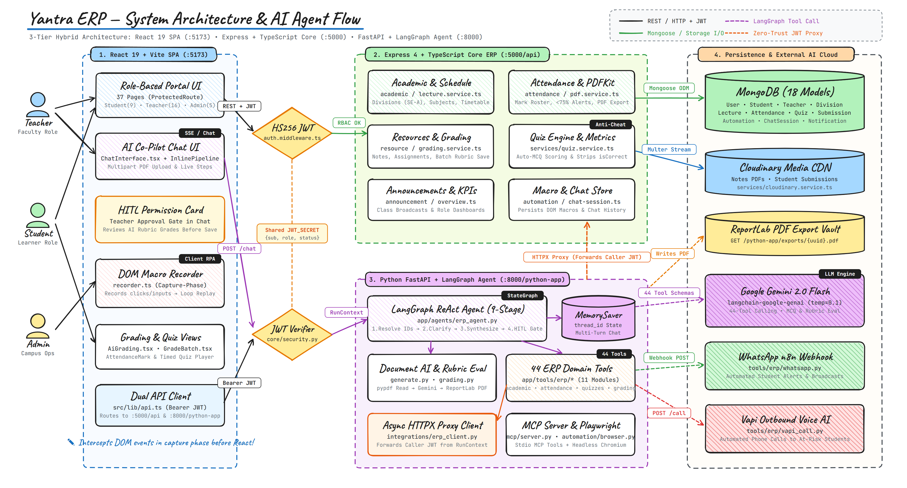
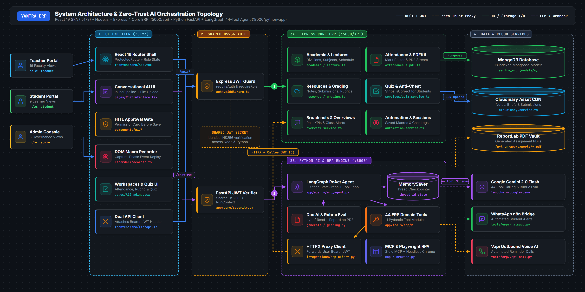
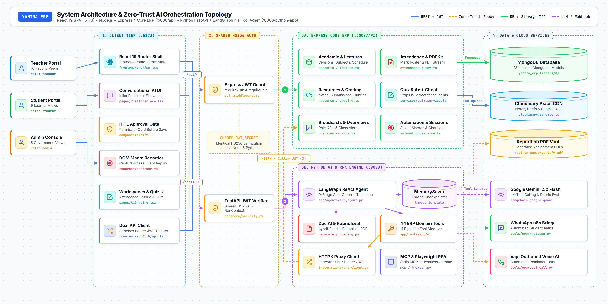
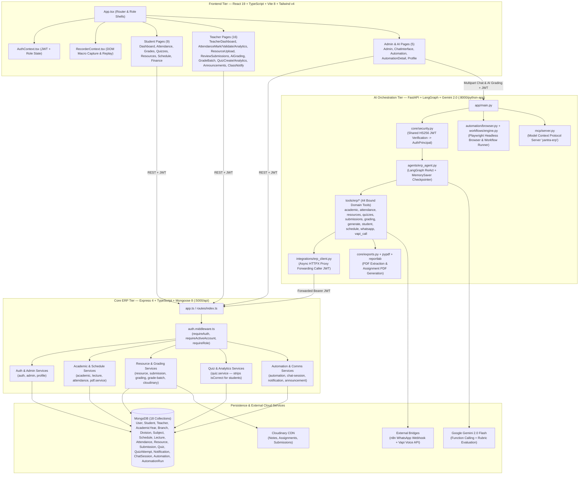
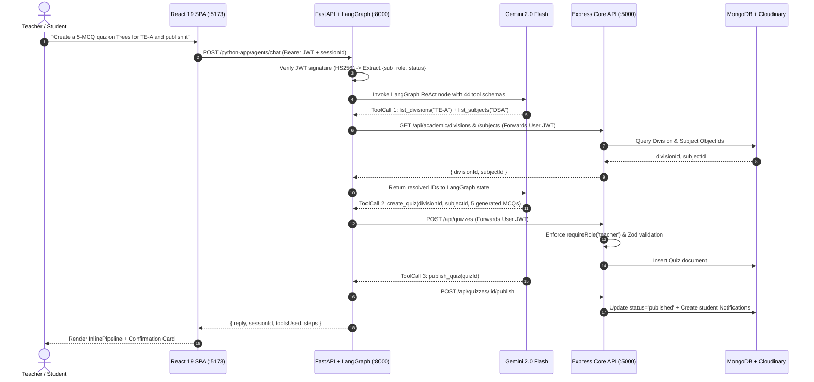
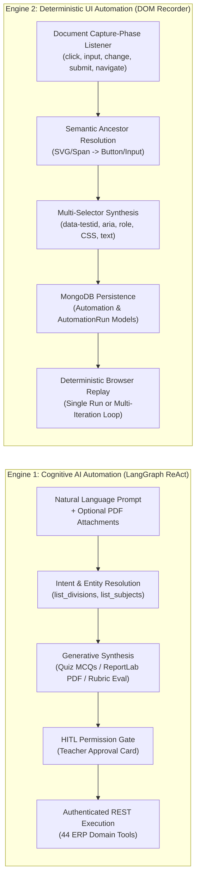
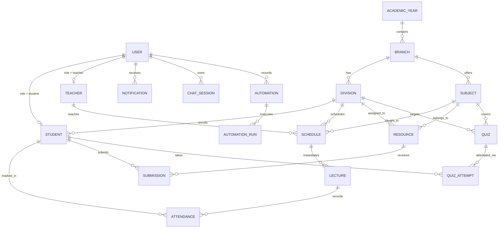

# Yantra — Full Codebase Knowledge Graph, Round 2 Architecture Blueprints & Master Prompts

> [!IMPORTANT]
> **Target Event:** Unstop — **Round 2: Solution Design & Technical Evaluation** (Live: 11 Nov – 15 Nov) & **Round 3: Prototype Development & Demonstration** (18 Nov – 25 Nov).
> **Judging Criteria Targeted:** Detailed Solution Design · Technical Architecture · Proposed Technologies · Implementation Strategy · Technical Feasibility · Innovation · Scalability.

---

## High-Resolution Engineering Architecture Diagrams (Round 2 Ready)

Below are three **human-grade node-and-edge architecture diagrams** (no AI text walls or Bento-grid paragraphs) built directly from the live **Yantra** codebase (`frontend/`, `express-backend/`, and `python-backend/`):

1. **Authentic Excalidraw Hand-Drawn Whiteboard Sketch** (`Rough.js` double-stroke geometry, diagonal hachure fills, stick-figure actors, diamond JWT gates, 3D database cylinders, and handwritten typography).
2. **Eraser.io Dark Cloud Node-Edge Topology** (compact icon-first nodes, 3D database cylinders, numbered orthogonal connectors, dark dot-grid canvas).
3. **Draw.io / Eraser.io Light Cloud Node-Edge Topology** (clean light presentation theme with compact icon tiles, 3D cylinders, and orthogonal routing).


### Individual Full-Width Diagram Previews (For Direct Download / Slide Deck Export)

#### 1. Authentic Excalidraw Hand-Drawn Whiteboard Diagram (3600×1940 px)


#### 2. Eraser.io Dark Cloud Node-Edge Architecture (3600×1800 px)


#### 3. Draw.io / Eraser.io Light Cloud Node-Edge Architecture (3600×1800 px)


---

## Part 1: Full Codebase Knowledge Graph (`/graphify` Structural Map)

### 1.1 Graph Statistics & Topology Summary

| Subsystem | Nodes (Modules/Files) | Key Entities Exposed | Primary Outbound Edges |
| :--- | :--- | :--- | :--- |
| **Frontend (`frontend/src`)** | 37 Pages · 28 Components · 21 Lib Modules | `AuthContext`, `RecorderContext`, `AttendanceContext`, `ResourcesContext`, `NotificationContext` | Calls Express REST (`/api/*`) + Python AI (`/python-app/*`) with Bearer JWT |
| **Express Backend (`express-backend/src`)** | 18 Models · 18 Routes · 18 Controllers · 19 Services | REST API (`:5000/api`), Mongoose ODM, Cloudinary Upload, PDFKit Generator, JWT Issuer | Reads/Writes MongoDB (`yantra_erp`), Uploads to Cloudinary CDN |
| **Python AI Backend (`python-backend/app`)** | 5 API Routers · 4 Agents · 11 ERP Tool Modules (44 Tools) · 1 MCP Server · 1 Playwright Engine | LangGraph ReAct Agent (`:8000/python-app`), MemorySaver Checkpointer, ReportLab PDF Exporter | Verifies Express JWT (`HS256`), Calls Express `/api/*` as Authenticated Proxy, Calls Gemini 2.0 Flash API |

---

### 1.2 End-to-End Codebase Knowledge Graph



---

## Part 2: Complete Solution Design for Unstop Round 2 Submission

Use the structured sections below directly in your Unstop submission form, PDF document, or presentation slides.

### 2.1 Executive Summary & Problem Statement
Educational institutions operate on fragmented, high-friction software where faculty spend **40%+ of their non-teaching hours** clicking through nested menus to mark attendance, upload notes, author quizzes, cross-check submissions against rubrics, and notify at-risk students. Traditional ERPs are passive forms over databases—they record data manually but do not **execute work**.

**Yantra** transforms the campus ERP from a passive form-filling system into an **active, prompt-driven and macro-automated operating system**:
1. **Conversational ERP Execution (LangGraph + Gemini 2.0):** Faculty and students execute complex multi-step workflows via natural language (*"Read my Chapter 3 DSA notes PDF, generate a 5-question assignment PDF, upload it for division TE-A due Friday, and notify non-submitters"*).
2. **Deterministic DOM Macro Recording:** For repetitive UI tasks, teachers click **"Record Workflow"** once; Yantra captures semantic DOM selectors in real time and replays the exact workflow deterministically on demand or in loops.
3. **Human-in-the-Loop (HITL) AI Rubric Grading:** Extracts text from student PDF submissions, evaluates each criterion against the teacher's rubric using Gemini, and presents a structured approval gate before publishing grades.

---

### 2.2 Detailed Technical Architecture & Security Model



#### Key Architectural Decisions:
- **Zero-Privilege-Escalation AI Proxy:** The Python AI service never connects to MongoDB directly and never uses a master admin key. Instead, it verifies the user's JWT (`app/core/security.py`), binds the raw token into a request-scoped `ContextVar` (`app/agents/run_context.py`), and forwards that exact token on every outbound tool call (`app/integrations/erp_client.py`). Express enforces the exact same RBAC (`requireRole`, `requireActiveAccount`) and ownership checks whether a request comes from the UI or the AI agent.
- **Anti-Cheat Assessment Delivery:** In [`quiz.service.ts`](file:///c:/dev/PromptERP_hackthon_campus/prompt-ERP-procreator-hackathon/express-backend/src/services/quiz.service.ts#L407-L437), `findQuizForStudent` verifies division membership and strips `isCorrect` flags from all question options on the server before serialization, preventing students from inspecting network payloads for answers.
- **Human-in-the-Loop (HITL) Safety Gate for Grading:** AI grading tools (`grade_submissions_with_rubric` → `ask_grading_permission`) compute proposed marks and per-criterion feedback in session state, emitting a `PermissionResponse` card to the UI. Grades are only written to MongoDB after the teacher explicitly approves (`publish_proposed_grades` or `publish_one_grade`).

---

### 2.3 Dual-Engine Automation Architecture (Innovation Highlight)



---

### 2.4 Database Entity-Relationship Diagram (18 Mongoose Models)



---

### 2.5 Proposed Technologies & Justification Matrix

| Layer | Technology | Version | Why It Was Chosen (Technical Feasibility & Scalability) |
| :--- | :--- | :--- | :--- |
| **Frontend SPA** | React + TypeScript + Vite | React 19.2 / Vite 8 | React Compiler (`babel-plugin-react-compiler`) eliminates unnecessary re-renders across dense data tables; TailwindCSS v4 provides zero-runtime CSS performance. |
| **Core API** | Node.js + Express + TypeScript | Express 4.21 / TS 5.6 | High-throughput non-blocking I/O for concurrent campus traffic; strict Zod request validation and Helmet security headers. |
| **Database** | MongoDB + Mongoose ODM | Mongoose 8.8 | Flexible document schemas ideal for polymorphic quiz questions, nested rubric criteria, and variable-step DOM automation recordings; compound indexes on `(division, subject, status)`. |
| **AI Orchestration** | Python + FastAPI + LangGraph | FastAPI 0.115 / LangGraph 0.2 | Native async ASGI support; LangGraph provides deterministic state machines, cyclical tool-calling loops, and thread-persisted `MemorySaver` checkpoints across multi-turn clarifications. |
| **Foundation LLM** | Google Gemini 2.0 Flash | `gemini-2.0-flash` | Sub-second time-to-first-token, native parallel function calling across 44 bound tools, and 1M+ token context window for reading full lecture PDFs and student submissions. |
| **Document & Media** | Cloudinary + PyPDF + PDFKit + ReportLab | PyPDF 5 / ReportLab 4.2 | Offloads binary storage to Cloudinary CDN; server-side streaming PDF generation for official attendance rosters and AI-generated assignment sheets. |
| **Protocol & RPA** | Model Context Protocol (MCP) + Playwright | MCP 1.0 / Playwright 1.48 | Future-proofs Yantra by exposing all ERP tools over standard MCP stdio transport for external AI clients, alongside headless Chromium browser automation. |

---

### 2.6 Evaluation Rubric Alignment: Feasibility, Innovation & Scalability

1. **Technical Feasibility (Already Built & Verified):**
   - Unlike conceptual hackathon pitches, **Yantra is a working 3-tier system** with 18 database models, 18 REST route modules, 44 LangGraph AI tools, and 37 frontend views that compile and run cleanly.
   - Graceful degradation: If `GEMINI_API_KEY` is absent or rate-limited, the Python backend falls back to an offline stub without crashing core ERP operations.
2. **Core Innovations:**
   - **Zero-Click Entity Resolution:** Users never type internal codes or IDs. Saying *"DSA for TE-A"* automatically triggers `list_divisions` and `list_subjects` before executing the target tool.
   - **Notes-to-Assignment PDF Pipeline (`generate_assignment_from_notes`):** Reads a teacher's uploaded lecture notes PDF, synthesizes relevant assignment questions via Gemini, compiles a formatted PDF via ReportLab, and attaches it to a new ERP assignment resource in a single prompt.
   - **Hybrid AI + DOM Macro Automation:** Combines generative LLM reasoning with a capture-phase DOM event recorder that synthesizes fallback selector chains for 100% deterministic UI replay.
3. **Scalability & Production Strategy:**
   - **Stateless Horizontal Scaling:** Express API and FastAPI workers are stateless behind JWT auth and can scale horizontally across containers/EC2 instances behind an Nginx/ALB reverse proxy.
   - **Checkpointer Upgrade Path:** LangGraph's in-memory `MemorySaver` is architected behind a clean checkpointer interface that swaps directly to `AsyncPostgresSaver` or `RedisSaver` for multi-worker cluster deployments.
   - **CDN & Async Offloading:** Heavy binary uploads stream directly to Cloudinary; long-running workflows execute as non-blocking `asyncio.Task` background jobs (`WorkflowEngine`).

---

## Part 3: "Best of the Best" Master Prompts for AI Tools

Copy and paste these prompts into the respective AI tools to generate your presentation slides, visual cloud diagrams, and formal PDF documentation.

---

### Prompt 1: Master Prompt for Pitch Deck / Presentation Generators (Gamma.app, Claude, ChatGPT, Tome)

> **How to use:** Copy the block below and paste it into **Gamma.app** ("Generate from notes/prompt"), **Claude**, or **ChatGPT** to generate a complete 10-slide hackathon winning presentation for Round 2.

```markdown
Act as a Principal Solutions Architect and Hackathon Pitch Strategist. Create a comprehensive, high-impact, 10-slide technical presentation for "Yantra — The AI-Native & Macro-Automated Campus ERP" for Round 2 (Solution Design & Technical Evaluation).

The evaluation criteria are:
1. Detailed Solution Design
2. Technical Architecture
3. Proposed Technologies
4. Implementation Strategy
5. Technical Feasibility, Innovation, and Scalability

Use the exact factual details of our built system below—do not invent fake features:

PROJECT OVERVIEW:
- Name: Yantra (Intelligent Campus ERP & AI Automation Platform)
- Target Users: Students, Teachers/Faculty, and Campus Administrators.
- Core Problem: Legacy university ERPs are passive, click-heavy form databases. Faculty waste 40%+ of administrative time clicking through nested menus to mark attendance, create quizzes, grade PDF submissions against rubrics, and chase non-submitters.
- Solution: Yantra unifies a full-featured role-based campus ERP with a Dual-Engine Automation Layer:
  1) Cognitive AI Agent (LangGraph + Google Gemini 2.0 Flash) with 44 callable ERP tools that execute multi-step workflows from natural language and PDF attachments.
  2) Deterministic DOM Macro Recorder that captures browser interactions (click, input, select, navigate) in capture phase and replays them in automated loops.

SLIDE-BY-SLIDE STRUCTURE REQUIRED:
- Slide 1: Title & Vision — Yantra: Transforming Campus ERPs from Passive Databases into Autonomous Execution Engines.
- Slide 2: The Problem — Institutional Fragmentation, Administrative Bottlenecks, Delayed Feedback Loops, and Legacy UI Friction.
- Slide 3: Solution Design — Role-Based Unified Workspace (Student Portal, Teacher Command Center, Admin Governance Console) + AI Co-Pilot.
- Slide 4: High-Level Technical Architecture — 3-Tier Micro-Architecture:
  * Frontend: React 19.2, TypeScript, Vite 8, TailwindCSS v4, React Compiler.
  * Core Transactional API: Node.js, Express 4, TypeScript, Mongoose 8 (18 collections), Zod, PDFKit, Cloudinary CDN.
  * AI Orchestration Layer: Python 3.11, FastAPI, LangChain, LangGraph (ReAct state machine + MemorySaver), Google Gemini 2.0 Flash, PyPDF, ReportLab, Playwright, Model Context Protocol (MCP) server.
- Slide 5: Deep-Dive Innovation 1 — LangGraph 9-Stage ReAct Pipeline & 44 Domain Tools:
  * Intent detection -> Automatic Entity Resolution (resolving "TE-A" or "DSA" to MongoDB ObjectIds via list_divisions/list_subjects) -> Parameter Extraction -> Multi-turn Clarifying Questions -> Generative Content Synthesis (Notes PDF to Assignment PDF via ReportLab; Auto-MCQ generation) -> Authenticated Execution.
- Slide 6: Deep-Dive Innovation 2 — Human-in-the-Loop (HITL) AI Rubric Grading & Zero-Privilege Security:
  * PyPDF extracts student submission PDFs -> Gemini evaluates criterion-by-criterion against teacher rubrics -> Emits interactive Permission Approval Card -> Only writes to MongoDB upon teacher approval.
  * Zero-Trust Proxy: FastAPI verifies Express HS256 JWTs and forwards the caller's exact token to Express so RBAC and IDOR protections are never bypassed. Server-side stripping of `isCorrect` quiz flags prevents student network inspection cheating.
- Slide 7: Deep-Dive Innovation 3 — Hybrid Automation (DOM Macro Recorder + Playwright + MCP):
  * Capture-phase DOM listener walks up from SVG/span nodes to semantic controls, builds multi-selector fallback arrays (data-testid, aria-label, role, CSS), persists to MongoDB, and replays deterministically.
  * Exposes all tools via Model Context Protocol (MCP) server ("yantra-erp").
- Slide 8: Database Architecture & API Surface — 18 Mongoose Models (User, Student, Teacher, AcademicYear, Branch, Division, Subject, Schedule, Lecture, Attendance, Resource, Submission, Quiz, QuizAttempt, Notification, ChatSession, Automation, AutomationRun) & 18 REST Route Modules.
- Slide 9: Implementation Strategy & Technical Feasibility — Working MVP Status, CI/CD GitHub Actions to AWS EC2 + PM2, Graceful Offline Fallback, and Testing Verification.
- Slide 10: Scalability & Future Roadmap — Stateless horizontal scaling, Redis/Postgres LangGraph checkpointer clustering, Cloudinary CDN offloading, and live Vapi Voice + WhatsApp n8n notification bridges.

Tone: Authoritative, deeply technical, concise, metric-driven, and visually structured with bullet points, comparison tables, and callout boxes.
```

---

### Prompt 2: Master Prompt for Visual Architecture Diagram Generators (Eraser.io, DiagramGPT, Whimsical, Draw.io)

> **How to use:** Paste this prompt into **Eraser.io (DiagramGPT)**, **Whimsical AI**, or **Draw.io AI** to generate a polished, presentation-ready cloud architecture diagram for your slides.

```markdown
Generate a detailed, professional Cloud & System Architecture Diagram for "Yantra — AI-Orchestrated Campus ERP".

Use 4 distinct visual swimlanes / clusters from Left to Right:

1. CLIENT & INTERACTION LAYER (Left):
   - "Actors": Student, Teacher, Campus Admin.
   - "React 19 + Vite 8 SPA (:5173)":
     * Role-Based Dashboards (Student / Teacher / Admin)
     * Conversational AI Chat UI + Inline Pipeline Visualizer
     * Capture-Phase DOM Macro Recorder & Replay Engine

2. API GATEWAY & SECURITY BOUNDARY (Center-Left):
   - "Stateless JWT Auth (HS256)": Shared token verification across both backends; Role Guards (student | teacher | admin) + Active Account Gate.

3. DUAL BACKEND EXECUTION LAYER (Center):
   - Cluster A: "Core Transactional Backend — Node.js + Express + TypeScript (:5000/api)"
     * Auth & Admin Approval Service
     * Academic, Schedule & Attendance Service (with PDFKit Roster Exporter)
     * Resource, Submission & Batch Grading Service
     * Quiz & Anti-Cheat Assessment Service (strips answer keys for students)
     * Notification, Announcement & Macro Storage Service
   - Cluster B: "AI Orchestration & Automation Backend — Python 3.11 + FastAPI (:8000/python-app)"
     * LangGraph ReAct Agent + MemorySaver Session Checkpointer
     * 44 Bound ERP Function-Calling Tools (Academic, Attendance, Quizzes, Resources, Submissions, Grading, Schedule)
     * Human-in-the-Loop (HITL) Rubric Grading Engine (PyPDF + ReportLab)
     * Playwright Headless Browser Runner & Workflow Engine
     * Model Context Protocol (MCP) Server ("yantra-erp")
   - Show an arrow labeled "Authenticated HTTPX Proxy (Forwards User Bearer JWT)" from Cluster B to Cluster A.

4. DATA & EXTERNAL CLOUD SERVICES (Right):
   - "MongoDB Database (yantra_erp)": 18 Collections (Users, Divisions, Subjects, Lectures, Attendance, Resources, Submissions, Quizzes, QuizAttempts, Automations, etc.) connected to Express via Mongoose 8.
   - "Cloudinary CDN": Connected to Express for PDF/Document storage.
   - "Google Gemini 2.0 Flash API": Connected to LangGraph Agent for tool calling, MCQ synthesis, and rubric evaluation.
   - "External Notification Bridges": Vapi Outbound Voice API & n8n WhatsApp Webhook connected to Python tools.

Style: Clean modern enterprise architecture, color-coded clusters (Blue for Frontend, Green for Node/Express, Purple for Python/AI, Orange for Databases & External APIs), orthogonal directional arrows with clear protocol labels.
```

---

### Prompt 3: Master Prompt for Formal Technical Evaluation Document / Whitepaper (Claude / ChatGPT)

> **How to use:** If the Unstop submission allows or requires uploading a **Detailed Solution Design PDF / Technical Report**, paste this prompt into Claude or ChatGPT and export the output to PDF.

```markdown
Act as a Principal Staff Engineer writing an official "Solution Design & Technical Evaluation Document" for our project **Yantra** for Round 2 of a national hackathon.

Write a complete, formal, engineering-grade document structured into the following 7 sections:

1. **Executive Summary & Problem Analysis**: Quantify the operational inefficiencies of fragmented college management systems and explain how Yantra solves them via conversational AI orchestration and deterministic UI macro automation.
2. **System Architecture & Component Design**: Detail our 3-tier architecture:
   - Frontend: React 19, TypeScript, Vite 8, TailwindCSS v4, React Router v7, Capture-phase DOM Recorder.
   - Transactional Backend: Node.js, Express 4.21, TypeScript 5.6, Mongoose 8, Zod validation, Helmet, Winston, PDFKit.
   - AI & Automation Backend: Python 3.11, FastAPI, LangChain, LangGraph ReAct state machine, Google Gemini 2.0 Flash, PyPDF, ReportLab, Playwright, MCP Server.
3. **Deep-Dive: LangGraph ReAct Agent & 44-Tool Execution Pipeline**: Explain the 9-step lifecycle of a prompt (Intent detection -> Entity resolution via `list_divisions`/`list_subjects` -> Parameter extraction -> Clarifying question loop via `MemorySaver` -> Content generation -> Tool execution -> Human-in-the-Loop approval gate).
4. **Deep-Dive: Security, RBAC & Anti-Cheat Architecture**:
   - Shared HS256 JWT verification between Express and FastAPI.
   - Request-scoped ContextVar token forwarding (`RunContext`) ensuring the AI agent never bypasses Express RBAC (`requireRole`) or IDOR ownership checks.
   - Server-side stripping of `isCorrect` flags in `findQuizForStudent`.
   - Path-traversal protection on generated PDF exports.
5. **Data Model Specification**: Summarize the 18 MongoDB collections (`User`, `Student`, `Teacher`, `AcademicYear`, `Branch`, `Division`, `Subject`, `Schedule`, `Lecture`, `Attendance`, `Resource`, `Submission`, `Quiz`, `QuizAttempt`, `Notification`, `ChatSession`, `Automation`, `AutomationRun`) and their indexing strategy.
6. **Implementation Strategy & Prototype Readiness (Round 3 Readiness)**: Highlight that 100% of the core platform is implemented, type-checked, and deployed with automated seed scripts (`seed:admin`, `seed:demo`, `seed:quizzes`, `seed:attendance`, `seed:grade-batch`, `seed:student-data`) and GitHub Actions CI/CD (`deploy.yml`).
7. **Scalability, Reliability & Fault Tolerance**: Cover stateless horizontal scaling, Redis/Postgres LangGraph checkpointer migration, Cloudinary CDN offloading, and graceful offline AI fallback.

Include markdown tables, API endpoint summaries, and clear technical justifications under every section.
```

---

### Prompt 4: Master Context Prompt for Coding / Extending Yantra (Round 3 Prototype Polish)

> **How to use:** Paste this into any AI coding assistant whenever you want to build new features or polish the prototype for Round 3.

```markdown
You are working on **Yantra**, a 3-tier AI-native Campus ERP monorepo:
1. `frontend/`: React 19 + TypeScript + Vite 8 + TailwindCSS v4 (`VITE_API_URL=http://localhost:5000/api`, `VITE_AI_API_URL=http://localhost:8000/python-app`).
2. `express-backend/`: Express 4 + TypeScript + Mongoose 8 (`src/models` has 18 models, `src/routes` has 18 route files mounted under `/api`, JWT auth in `src/middlewares/auth.middleware.ts`).
3. `python-backend/`: FastAPI + Python 3.11 (`uv`) mounted under `/python-app`. Uses LangGraph ReAct agent (`app/agents/erp_agent.py`) with Google Gemini (`gemini-2.0-flash`) and 44 tools in `app/tools/erp/`. Verifies Express JWTs using shared `JWT_SECRET` (`app/core/security.py`) and forwards the caller's token via `app/integrations/erp_client.py`.

Architectural invariants to preserve:
- Never bypass Express RBAC from Python; always forward the user's JWT via `erp_client`.
- Maintain strict TypeScript types (`npm run build` in both `express-backend` and `frontend` must pass with 0 errors).
- Any destructive or high-stakes AI action (such as publishing grades) must use the Human-in-the-Loop permission pattern (`PermissionResponse`).
```
